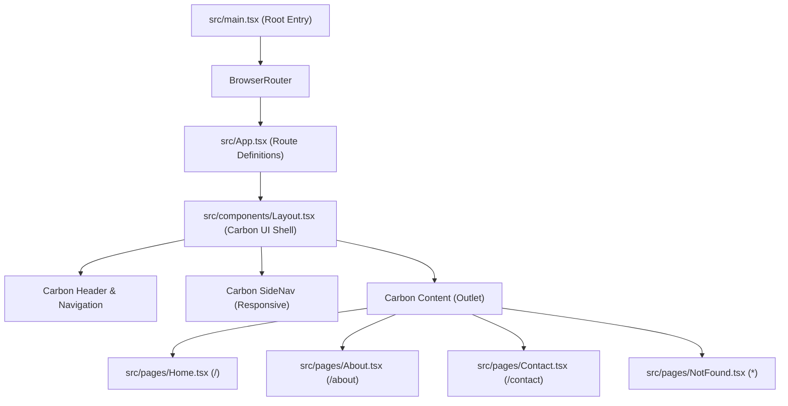

# Architecture

This document describes the architectural design, component hierarchy, styling system, and testing structure of the Beehive static application.

## Overview

Beehive is a static client-side web application built with:

- **React 19** for UI components and state management
- **Vite** for fast module bundling and development server
- **TypeScript** in strict mode for type safety
- **IBM Carbon Design System** (`@carbon/react`) for accessible, enterprise-grade UI components
- **react-router-dom** for declarative browser-based routing
- **Sass (SCSS)** for styling with Carbon design tokens and IBM Plex typography



## Application Structure

```
src/
├── components/          # Shared layout and UI components
│   ├── Layout.tsx       # IBM Carbon UI Shell wrapper with navigation
│   └── Layout.test.tsx  # Layout unit tests
├── pages/               # Route-level page components
│   ├── Home.tsx         # Hero banner, mission, and agent role tiles
│   ├── Home.test.tsx
│   ├── About.tsx        # Agent roster table and detailed accordion
│   ├── About.test.tsx
│   ├── Contact.tsx      # Contact form with validation and notifications
│   ├── Contact.test.tsx
│   ├── NotFound.tsx     # Catch-all 404 page
│   └── NotFound.test.tsx
├── test/
│   └── setup.ts         # Vitest setup and jest-dom matchers
├── App.tsx              # Application route tree
├── App.test.tsx         # Routing and layout integration tests
├── index.scss           # Sass configuration, Carbon imports, and layout classes
└── main.tsx             # DOM mounting with React 19 createRoot and BrowserRouter
```

## Navigation and Layout

The application UI is structured around the IBM Carbon Design System UI Shell (`src/components/Layout.tsx`):

1. **Header**: Contains the application title, `SkipToContent` accessibility link for keyboard navigation, and `HeaderNavigation` menu items for desktop viewports.
2. **SideNav**: Collapsible drawer navigation for mobile and smaller screens, synchronized with `HeaderMenuButton` toggling.
3. **Content Container**: Wraps the React Router `<Outlet />` inside Carbon's `<Content id="main-content">` to receive main landmark focus when skipping navigation.

## Routing Model

Routing is handled entirely on the client side via `react-router-dom`:

- `/`: Displays the Home page with introductory hero and feature tiles.
- `/about`: Displays the About page with an interactive agent roster and role descriptions.
- `/contact`: Displays the Contact form with client-side field validation and feedback notifications.
- `*`: Matches any unmatched URL and renders the NotFound component.

Because routing executes in the browser (`BrowserRouter`), production hosting environments must serve `dist/index.html` as the fallback for all unknown paths.

## Styling and Design Tokens

Styles are managed through Sass in `src/index.scss`:

- **Carbon Integration**: Loads `@carbon/react/scss/config` configured with the `@ibm/plex` font family path, followed by full `@carbon/react` styles.
- **Tokens and Variables**: Layout and component spacing use Carbon CSS tokens such as `var(--cds-spacing-04)`, `var(--cds-spacing-05)`, and `var(--cds-spacing-10)` rather than hardcoded pixel values.
- **Typography and Headings**: Elements use Carbon typography utility classes such as `cds--productive-heading-05`, `cds--body-long-01`, and `cds--label-01`.

## Testing and Quality Verification

The project enforces automated quality checks:

- **Unit and Integration Tests**: Built with Vitest and `@testing-library/react` in a jsdom environment. Tests run next to components in `*.test.tsx` files.
- **Coverage Enforcement**: Configured in `vite.config.ts` using `@vitest/coverage-v8`, failing if statements, branches, functions, or lines drop below 80%.
- **Static Analysis**: TypeScript strict mode (`tsc -b`) and ESLint flat configuration (`eslint.config.js`).
- **Formatting**: Prettier with `.prettierrc.json` rules (single quotes, no semicolons, trailing commas).
